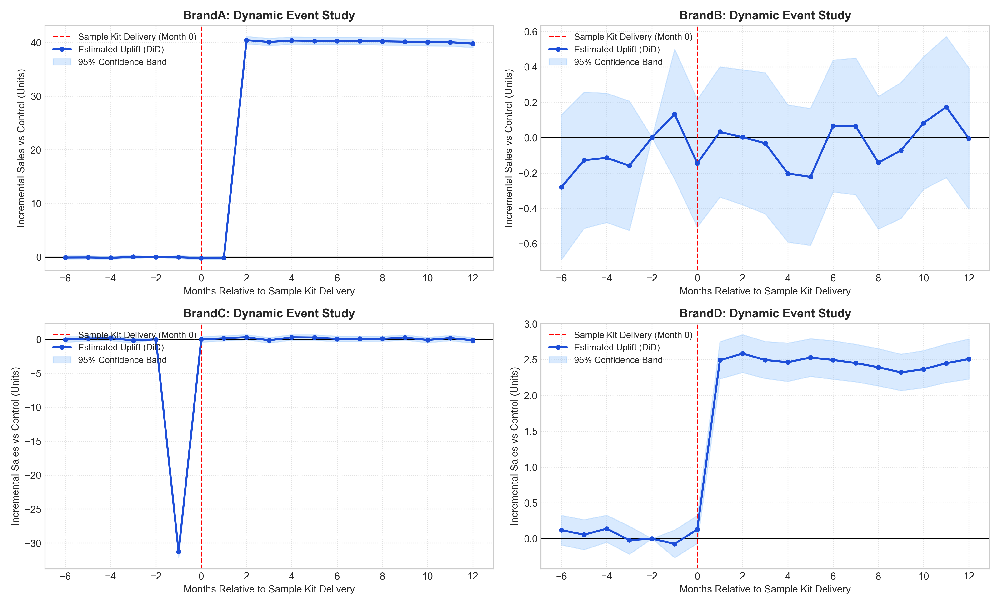

# B2B Healthcare Marketing: Causal Impact of Free Sample Kits on Commercial Adoption

> Evaluation of whether complimentary trial packs generate sustained clinic purchases across 3,500 clinics in Japan using Difference-in-Differences and Two-Way Fixed Effects.

---

## 1. Business Problem

In B2B medical marketing, pharmaceutical and device manufacturers distribute free sample kits to clinic doctors to encourage ongoing adoption. Standard commercial reports often rely on simple comparisons between clinics that received samples and those that did not. These naive comparisons can be misleading because:

- Naive comparisons mix in timing effects, such as general sales drift over calendar time and seasonal peaks.
- Sales reps sometimes send samples right after a clinic cuts its orders. The subsequent volume recovery is natural mean reversion rather than an effect of the sample kit.
- Mixing prospect clinics that never buy a product with active client accounts hides where sample kits actually work.

---

## 2. Analytical Approach

In this project, I used Difference-in-Differences (DiD) and panel data methods to isolate incremental volume:

1. **Naive Comparison**: Evaluates the initial sales difference and shows how calendar timing inflates the gap.
2. **Difference-in-Differences Intuition**: Subtracts baseline market trends from treated clinic changes.
3. **Dynamic Event Studies**: Tracks sales from 6 months before to 12 months after trial delivery to visually check the parallel trends assumption and identify adoption lags.
4. **Two-Way Fixed Effects (TWFE)**: Runs panel demeaning regressions controlling for clinic baselines and calendar month trends, with clustered standard errors.
5. **Segmented Deep Dives**: Checks percentage changes for mature products and compares active accounts against non-purchasing prospects.

---

## 3. Key Findings

Across 504,000 monthly transactions (3,500 clinics over 36 months across 4 brands):

| Brand | Naive difference | Uplift from TWFE (units/clinic/month) | Significant? | Recommendation |
|:---|:---:|:---:|:---:|:---|
| **BrandA** | +38.65 units | **+40.33 units / month** | Yes (p < 0.0001) | Keep and expand sampling |
| **BrandB** | +0.91 units | **+0.08 units / month** | No (p = 0.2071) | Stop sampling (no measurable effect) |
| **BrandC** | +0.86 units | **+0.03 units / month** | No (p = 0.7219) | Stop sampling; review why reps send kits after order drops |
| **BrandD** | +1.03 units | **+2.42 units / month** | Yes (p < 0.0001) | Sample only clinics that already buy BrandD |

Break-even assumptions (margin, kit cost) are illustrative. See notebook Section 9.

---

## 4. Dynamic Event Study

The 2x2 dynamic event study chart shows parallel pre-trends (months -6 to -2 stay close to zero) and illustrates post-treatment trajectories across all four products:



---

## 5. Repository Structure

```text
b2b-healthcare-causal-roi/
├── data/
│   ├── dim_brand.csv                           # Brand metadata, launch age, and pricing tiers
│   ├── dim_clinic.csv                          # Clinic size tiers, regions, and procurement channels
│   └── fact_clinic_month.csv                   # 504,000 monthly transaction and trial records
├── notebooks/
│   └── clinic_trial_causal_evaluation.ipynb    # Main end-to-end causal evaluation notebook
├── src/
│   ├── __init__.py                             # Module exports
│   └── did_helpers.py                          # Panel demeaning, balance check, and relative month helpers
├── figures/
│   └── event_study_by_brand.png                # Dynamic event study 2x2 grid visualization
├── requirements.txt                            # Core dependencies
├── .gitignore
└── README.md                                   # Project documentation
```

---

## 6. How to Run Locally

```bash
# 1. Install dependencies
pip install -r requirements.txt

# 2. Launch Jupyter Notebook or Jupyter Lab
jupyter notebook notebooks/clinic_trial_causal_evaluation.ipynb
```

Click **Kernel -> Restart & Run All** to reproduce all tables and charts.

---

## 7. Skills & Tools

- **Causal Inference**: Difference-in-Differences (DiD), Two-Way Fixed Effects (TWFE), Dynamic Event Studies, Parallel Trends Check, Clustered Standard Errors.
- **Python**: `pandas`, `numpy`, `matplotlib`, `statsmodels`.
- **Business Intelligence**: Break-even analysis, customer segmentation, data visualization.

## 8. Reference for future studies
- Causal Inference: The Mixtape by Scott Cunningham
- The Effect: An Introduction to Research Design and Causality by Nick Huntington-Klein
